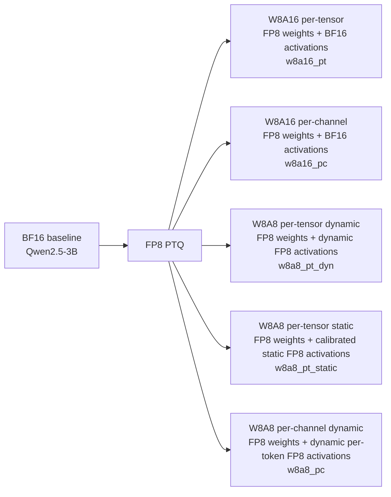
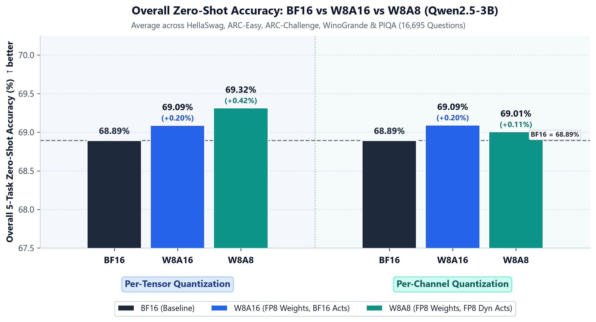
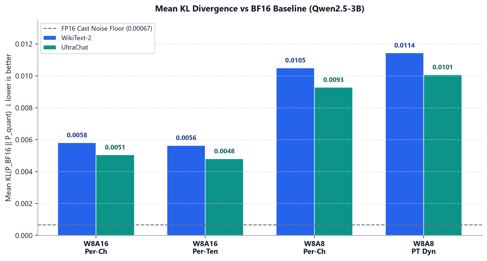
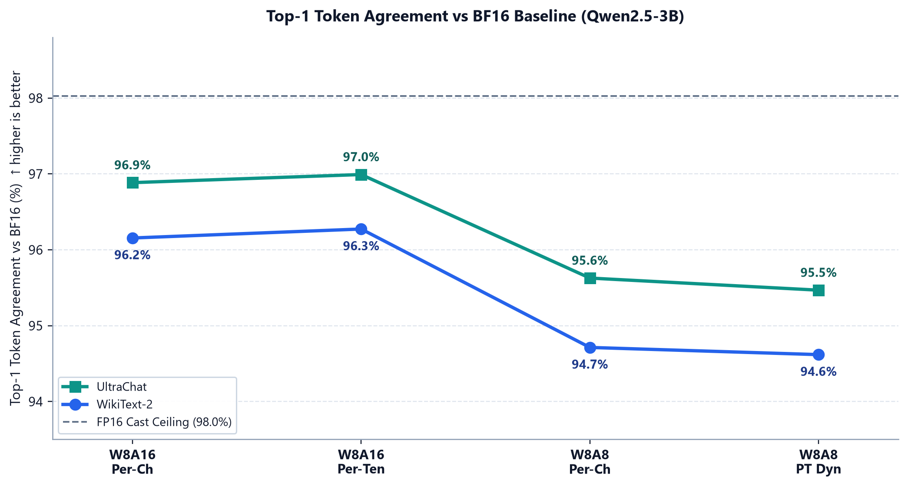
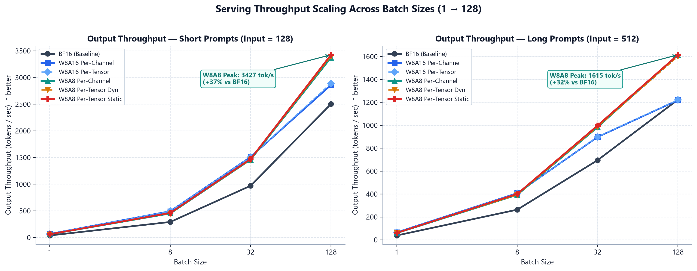

# FP8 Post-Training Quantization Study

Evaluation of FP8 post-training quantization (PTQ) for **Qwen2.5-3B** on an **NVIDIA L4 (24 GB, Ada, compute capability 8.9)**. The study compares model quality, probability-distribution fidelity, checkpoint size, and serving performance against a BF16 baseline.

> **Scope:** inference-only PTQ. No fine-tuning, quantization-aware training, or gradient updates were used.

## Key findings

- FP8 checkpoints are about **45% smaller** than BF16: 6.17 GB to 3.40 GB, freeing roughly 2.6 GiB of GPU memory for serving.
- **W8A16 per-channel (`w8a16_pc`)** is the preferred low-batch, latency-sensitive option: 14.7 ms/token TPOT at batch 1 versus 25.5 ms/token for BF16, with 69.09% average zero-shot accuracy versus 68.89% for BF16.
- **W8A8 per-channel (`w8a8_pc`, dynamic per-token activations)** is the preferred high-batch option: up to 3,374 output tokens/s at batch 128 with 128-token prompts (about 35% above BF16), and 1,613 tokens/s with 512-token prompts (about 32% above BF16).
- W8A8 increases distribution shift compared with W8A16, so deployment choice depends on whether throughput or fidelity/latency is more important.
- Static per-tensor W8A8 is not recommended for this setup: it requires calibration, has the largest reported KL shift, and offers little serving gain over dynamic per-channel W8A8.

These are measurements for the model, hardware, software versions, and workloads described here; they should not be assumed to generalize to other GPUs or serving stacks.

## Quantization paths from the BF16 baseline

Each branch starts from the same BF16 model and produces one FP8 post-training quantization (PTQ) recipe. W8A16 keeps activations in BF16; W8A8 quantizes activations as well.



### Quantization recipes

| Recipe | Weights | Activations | Scale / calibration |
|---|---|---|---|
| `w8a16_pt` | FP8 per-tensor | BF16 | Per-tensor; no calibration |
| `w8a16_pc` | FP8 per-channel | BF16 | Per-channel; no calibration |
| `w8a8_pc` | FP8 per-channel | FP8 dynamic per-token | Dynamic; no calibration (`FP8_DYNAMIC`) |
| `w8a8_pt_dyn` | FP8 per-tensor | FP8 dynamic per-tensor | Dynamic; no calibration |
| `w8a8_pt_static` | FP8 per-tensor | FP8 static per-tensor | Static scales; 512 calibration samples |

The study quantizes the 252 Linear modules across 36 decoder blocks. Embeddings, normalization layers, and `lm_head` remain BF16. The project uses real quantized checkpoints for serving measurements and a PyTorch simulation track for distribution and layer diagnostics.

### Evaluation

- **Zero-shot accuracy:** HellaSwag, ARC-Easy, ARC-Challenge, WinoGrande, and PIQA; 16,695 questions in total. Paired accuracy comparisons use the exact McNemar test as recorded in the project findings.
- **Distribution fidelity:** full-vocabulary KL divergence and next-token agreement against BF16 on WikiText-2 and UltraChat. WikiText-2 perplexity/loss is also measured.
- **Serving:** vLLM on an NVIDIA L4, across batch sizes 1, 8, 32, and 128 and prompt lengths of 128 and 512 tokens. Metrics include decode TPOT, prefill time, end-to-end latency, and output throughput.
- **Software:** vLLM 0.34.0; the experiment plan records `llm-compressor` 0.15.0 and `lm-eval` 0.4.13.

## Results and deployment conclusion

For the tested NVIDIA L4 setup, use **W8A16 per-channel (`w8a16_pc`) for single-user interactive serving and batch sizes up to 32**. It has the lowest measured single-user decode latency and strong probability fidelity. For **larger batches and higher concurrent user counts, use W8A8 per-channel dynamic (`w8a8_pc`)**: at batch 128 it provides the strongest measured throughput, particularly for long prompts, using the L4's native FP8 compute. The benchmark grid tested batches 1, 8, 32, and 128, so it establishes the advantage at the tested low and high endpoints; the precise crossover between 32 and 128 was not sampled.

The trade-off is visible in KL: W8A16 per-channel has lower mean KL than W8A8 per-channel on both WikiText-2 and UltraChat, while W8A8 buys serving throughput at high batch. The KL charts at the end compare those methods directly. Lower KL means closer next-token probability distributions to BF16; it does not by itself establish equal downstream task accuracy.

## Selected results

The figures below provide an overview of accuracy, output fidelity, storage savings, and serving performance. The three KL figures above add detailed fidelity comparisons for the two recommended recipes.

### 1. Overall zero-shot accuracy

Compares the BF16 baseline with W8A16 and W8A8 using per-tensor and per-channel scaling. The plotted averages are 68.89% for BF16, 69.09% for W8A16, and 69.32% / 69.01% for the W8A8 per-tensor / per-channel results shown.



### 2. Accuracy across all evaluated methods

Use this comparison for task-level results and the full set of quantization recipes.


### 3. Mean KL divergence

Lower KL means the quantized model's next-token probability distribution is closer to BF16. The chart separates WikiText-2 and UltraChat results and marks the FP16 cast noise floor.



### 4. Top-1 token agreement

Shows how often each quantized model selects the same next token as BF16 on WikiText-2 and UltraChat.



### 5. Checkpoint size and compression

The FP8 checkpoints are approximately 45% smaller than the BF16 baseline.


### 6. End-to-end request latency

Breaks request time into prefill and decode for single-user, medium-batch, and heavy-batch workloads.


### 7. Serving throughput scaling

Compares output throughput across batch sizes for short (128-token) and long (512-token) prompts.



## Repository guide

| Path | Contents |
|---|---|
| `fp_8/` | FP8 configuration, checkpoint creation, evaluation, diagnostics, plotting, and serving benchmarks |
| `accuracy_plots/` | Accuracy, KL, token-agreement, perplexity, and checkpoint-size figures and plotting scripts |
| `time_plots/` | Decode, prefill, end-to-end latency, throughput figures and plotting script |
| `results/` | Recorded evaluation outputs, summaries, manifests, and diagnostic plots |
| `docs/findings.md` | Detailed findings, deployment recommendations, and methodological notes |
| `plan.md` | Experiment plan and implementation notes |
| `present.md` | Management presentation narrative and detailed scorecard |
| `requirements.txt` | Python dependencies for the local plotting / analysis environment |

## Reproducing plots

From the repository root, install the dependencies in `requirements.txt`, then run the relevant plotting scripts:

```bash
python accuracy_plots/plot_accuracy.py
python accuracy_plots/plot_pt_pc_accuracy.py
python accuracy_plots/plot_kl_executive_summary.py
python accuracy_plots/plot_pt_pc_kl.py
python time_plots/plot_time.py
```

The scripts may regenerate figure files from the result data and configuration available in this checkout. Running cloud-based model evaluation or serving benchmarks requires the corresponding Modal/GPU setup and model/data access; plot generation alone does not rerun those experiments.

## Further details

- [Detailed findings and deployment guidance](docs/findings.md)
- [FP8 accuracy plot catalogue](accuracy_plots/README.md)
- [Presentation and full scorecard](present.md)
- [Experiment plan](plan.md)

## KL comparison plots

The following KL figures are collected at the end for direct comparison. Lower KL indicates a next-token probability distribution closer to the BF16 reference; read it alongside downstream accuracy and serving results.

### W8A16 per-channel vs BF16

Mean KL is 0.0058 nats, below the figure's 0.05 reference threshold. The summary also shows token-level KL distribution, top-1 agreement, zero-shot accuracy, checkpoint size, and batch-1 decode latency.


### W8A8 per-channel vs BF16

Mean KL is 0.0105 nats. W8A8 per-channel has a larger distribution shift than W8A16 per-channel, alongside its throughput advantage at high batch.


### Direct W8A16 vs W8A8 comparison

This figure compares mean KL with 95% confidence intervals and 99th-percentile tail KL on WikiText-2 and UltraChat. W8A8 per-channel has higher mean and tail KL on both datasets in these results.


