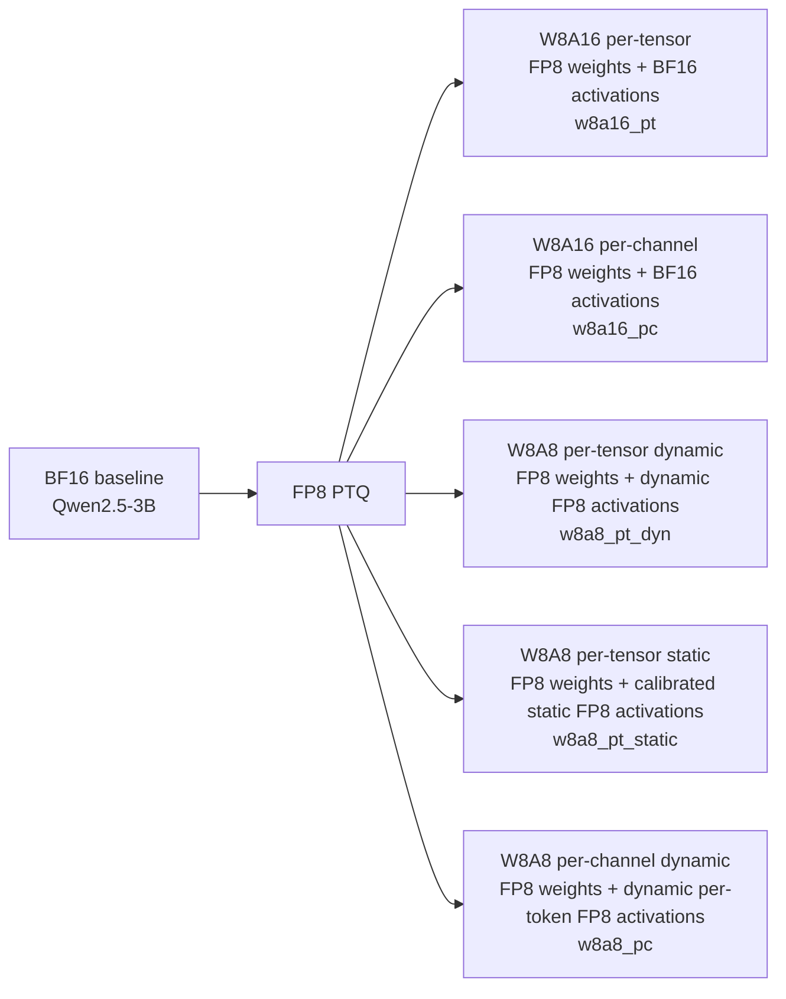
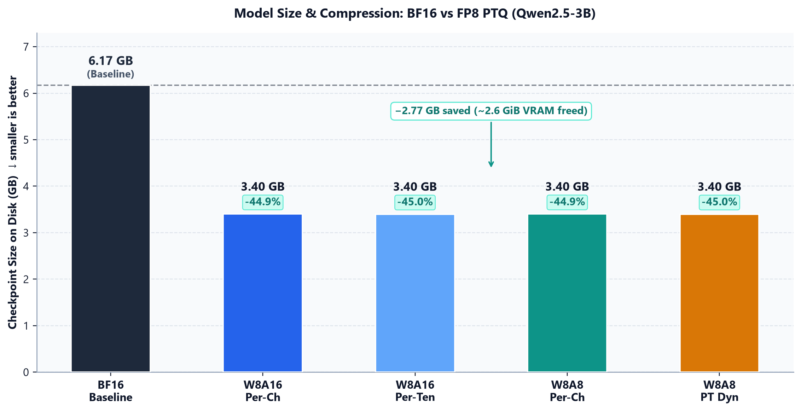
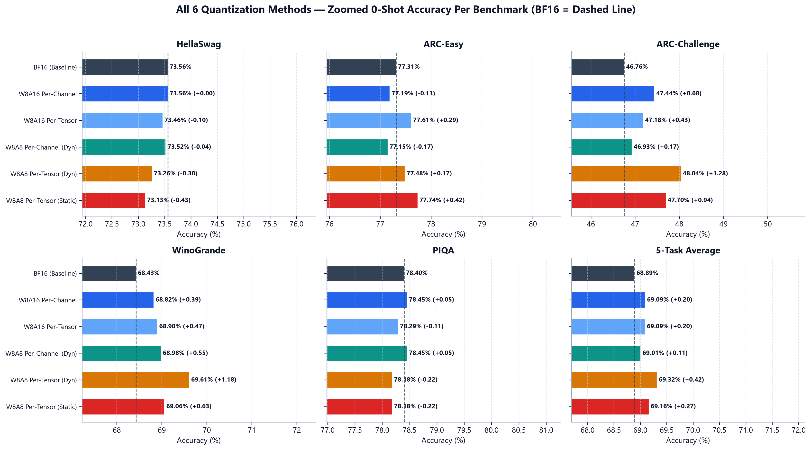
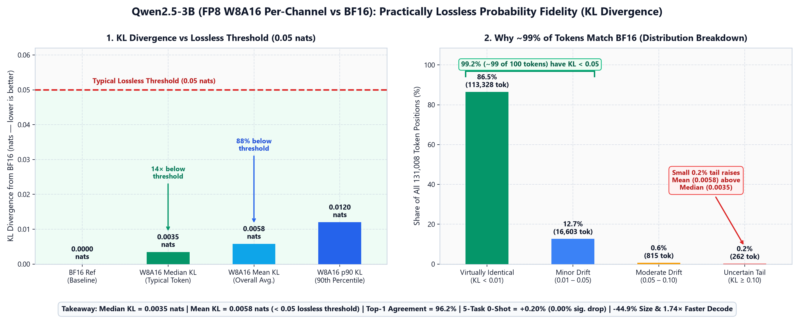
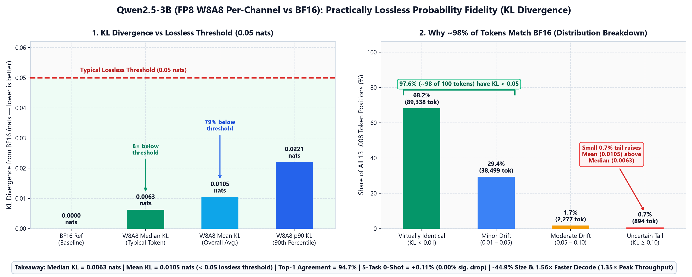
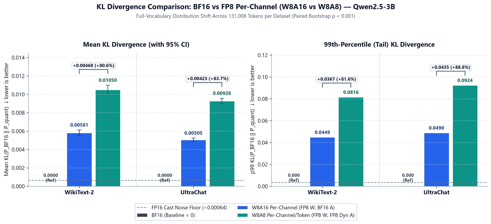
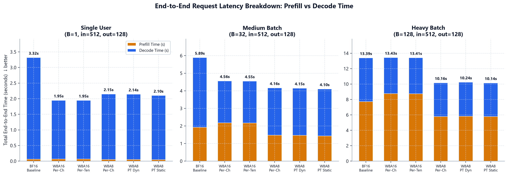

# FP8 Post-Training Quantization Study: Qwen2.5-3B on NVIDIA L4

> **Model:** `Qwen/Qwen2.5-3B` (BF16 baseline) · **Hardware:** NVIDIA L4 (24 GB, Ada Lovelace, cc 8.9) · **Serving:** `vLLM 0.34.0` · **Scope:** Inference-only Post-Training Quantization (PTQ) — zero fine-tuning, QAT, or gradient updates.

---

## Table of Contents

1. [Abstract & Executive Summary](#1-abstract--executive-summary)
2. [Experimental Methodology](#2-experimental-methodology)
3. [Empirical Results & Analysis](#3-empirical-results--analysis)
   - [3.1 Model Footprint & Compression](#31-model-footprint--compression)
   - [3.2 Downstream Zero-Shot Accuracy](#32-downstream-zero-shot-accuracy)
   - [3.3 Probability-Distribution Fidelity (KL Divergence & Token Agreement)](#33-probability-distribution-fidelity-kl-divergence--token-agreement)
   - [3.4 Serving Latency & Throughput Scaling](#34-serving-latency--throughput-scaling)
4. [Master Comparison Scorecard & Root-Cause Diagnostics](#4-master-comparison-scorecard--root-cause-diagnostics)
5. [Conclusions, Deployment Recommendations & Key Takeaways](#5-conclusions-deployment-recommendations--key-takeaways)
6. [Repository Structure & Reproducibility](#6-repository-structure--reproducibility)

---

## 1. Abstract & Executive Summary

This study evaluates five **FP8 Post-Training Quantization (PTQ)** recipes for **Qwen2.5-3B** on an **NVIDIA L4 (24 GB, Ada, compute capability 8.9)** against an unquantized **BF16** baseline. Every recipe is assessed across four dimensions: **checkpoint compression**, **zero-shot downstream accuracy** (16,695 questions), **full-vocabulary probability-distribution fidelity** (KL divergence, next-token agreement, and perplexity across 262,016 tokens), and **live vLLM serving performance** across batch sizes `1–128` and prompt lengths `128–512`.

### Headline Findings

- **Uniform ~45% compression:** All five FP8 checkpoints shrink from **6.17 GB to 3.40 GB** (~44.9–45.0% reduction), freeing roughly **2.6 GiB of GPU VRAM** for KV cache. Per-channel scaling adds only 2.1 MB (0.06%).
- **Zero downstream accuracy collapse:** Across five zero-shot benchmarks, BF16 averages **68.89%** while all FP8 recipes average **69.01%–69.32%**. Exact McNemar tests confirm **zero statistically significant drops** on any task for `w8a16_pc`, `w8a16_pt`, and `w8a8_pc`.
- **Activation quantization drives distribution shift:** Quantizing activations (`W8A8`) roughly doubles full-vocabulary KL divergence compared to weight-only FP8 (`W8A16`) on both WikiText-2 and UltraChat (`p < 0.001`), though both remain under **+0.75% perplexity** relative to BF16.
- **Clear L4 hardware speed crossover:**
  - **Low-batch / latency-sensitive serving (`B ≤ 32`):** **`w8a16_pc`** wins via the Marlin kernel — **14.66 ms/token** decode TPOT at `B=1` (**1.74× faster** than BF16's 25.55 ms/token) with the highest fidelity.
  - **High-batch / prefill-heavy serving (`B = 128` or long prompts):** **`w8a8_pc`** (`FP8_DYNAMIC`) wins via native Ada FP8 Tensor Cores — up to **3,374 output tok/s** (+35% vs BF16) on 128-token prompts and **1,613 tok/s** (+32%) on 512-token prompts.
- **Static per-tensor W8A8 (`w8a8_pt_static`) is dominated:** It requires 512 calibration samples, incurs the largest KL shift (+45% worse than `w8a8_pc`), and is the only recipe with a `p < 0.01` downstream drop (HellaSwag `-0.43 pp`), for `<2%` extra throughput.

> *Scope note: All measurements are specific to Qwen2.5-3B, NVIDIA L4 (cc 8.9), and vLLM 0.34.0; results should not be assumed to generalize verbatim to other model scales, GPU architectures, or serving stacks.*

---

## 2. Experimental Methodology

### 2.1 Quantization Architecture & Recipes

Each recipe branches from the identical **BF16 Qwen2.5-3B** checkpoint using one-shot FP8 E4M3 conversion via `llm-compressor`. All **252 Linear modules** across the 36 decoder blocks are quantized; token embeddings, normalization layers, and `lm_head` remain in `bfloat16` to protect input representations and output logits.



| Recipe | Weights | Activations | Calibration | L4 Serving Kernel |
|---|---|---|---|---|
| **`w8a16_pt`** | FP8 per-tensor | BF16 | None | Marlin (weight-only) |
| **`w8a16_pc`** | FP8 per-channel | BF16 | None | Marlin (weight-only) |
| **`w8a8_pc`** (`FP8_DYNAMIC`) | FP8 per-channel | FP8 dynamic per-token | None | Native FP8 Tensor Cores |
| **`w8a8_pt_dyn`** | FP8 per-tensor | FP8 dynamic per-tensor | None | Native FP8 Tensor Cores |
| **`w8a8_pt_static`** | FP8 per-tensor | FP8 static per-tensor | 512 UltraChat samples | Native FP8 Tensor Cores |

### 2.2 Evaluation Protocol & Dual-Track Validation

- **Dual-track rigor:** **Track B** runs real `.safetensors` checkpoints inside `vLLM 0.34.0` on NVIDIA L4 for perplexity, downstream benchmarks, and serving speed. **Track A** runs PyTorch fake-quantization for full-vocabulary KL divergence and 252-layer diagnostics. Cross-track validation confirms **0.06%** BF16 WikiText-2 PPL agreement (`7.778` vs `7.782`) and `4.0 × 10⁻⁴` max weight RMSE.
- **Zero-shot accuracy (`lm-eval 0.4.13`):** 5 benchmarks totaling **16,695 questions** — HellaSwag (`10,042`), ARC-Easy (`2,376`), ARC-Challenge (`1,172`), WinoGrande (`1,267`), and PIQA (`1,838`). Paired significance vs BF16 is evaluated via the **exact McNemar test**.
- **Distribution fidelity:** Full-vocabulary KL divergence (`152,064` vocab), top-1 next-token agreement, and perplexity over **131,008 tokens per dataset** (64 paired windows) on **WikiText-2** (general prose) and **UltraChat** (instruction/chat), with paired 95% bootstrap confidence intervals.
- **Serving benchmarks:** `vLLM 0.34.0` on NVIDIA L4 across batch sizes `B ∈ {1, 8, 32, 128}` and prompt lengths `in ∈ {128, 512}` (128 output tokens), measuring decode **TPOT**, **prefill/TTFT**, **end-to-end latency**, and **output throughput (tok/s)**.

---

## 3. Empirical Results & Analysis

### 3.1 Model Footprint & Compression



**Figure 1 — Checkpoint Size and Compression Ratio.** All five FP8 recipes reduce total checkpoint size uniformly by **44.9%–45.0%**, shrinking Qwen2.5-3B from **6.17 GB (`5.75 GiB` weights)** down to **3.40 GB (`3.16–3.17 GiB`)**. This frees **~2.6 GiB of GPU VRAM** on the 24 GB L4 for larger KV-cache capacity and higher concurrency. Because per-channel scale tensors add only **2.1 MB (`0.06%`)** over per-tensor scaling, finer weight granularity carries virtually zero memory penalty. The remaining ~55% of checkpoint size comes from unquantized BF16 embeddings and `lm_head`, which are intentionally preserved to protect output logits.

---

### 3.2 Downstream Zero-Shot Accuracy


**Figure 2 — Overall Zero-Shot Accuracy (Per-Tensor vs. Per-Channel).** Across all 16,695 zero-shot questions, FP8 quantization preserves the BF16 baseline (**68.89%**): `w8a16_pt` and `w8a16_pc` both average **69.09%** (`+0.20 pp`), `w8a8_pc` averages **69.01%** (`+0.11 pp`), and `w8a8_pt_dyn` averages **69.32%** (`+0.42 pp`). Exact McNemar tests confirm **zero statistically significant degradations** on any task for `w8a16_pc`, `w8a16_pt`, or `w8a8_pc`.



**Figure 3 — Task-Level Zero-Shot Accuracy Across All Evaluated Methods.** Breaking out all five individual benchmarks (`HellaSwag`, `ARC-Easy`, `ARC-Challenge`, `WinoGrande`, `PIQA`) reveals two key insights: (1) **`w8a8_pt_static`** is the only recipe in the entire study to exhibit a `p < 0.01` accuracy drop (`-0.43 pp` on HellaSwag, the largest and highest-powered benchmark at `N = 10,042`), while `w8a8_pt_dyn` shows a mild `p < 0.05` dip (`-0.30 pp`); and (2) standard 5-task multiple-choice averages are too coarse to separate small FP8 shifts (`ΔPPL < 0.08`), motivating full-vocabulary KL divergence analysis next.

---

### 3.3 Probability-Distribution Fidelity (KL Divergence & Token Agreement)


**Figure 4 — Mean Full-Vocabulary KL Divergence vs. BF16.** Measuring exact next-token probability shift across all 152,064 vocabulary tokens cleanly separates the recipes (`p < 0.001` paired bootstrap). Weight-only quantization (`w8a16_pt`: `0.00564`, `w8a16_pc`: `0.00581` nats on WikiText-2) introduces roughly half the distribution shift of activation-quantized recipes (`w8a8_pc`: `0.01050`, `w8a8_pt_dyn`: `0.01144`), while static calibration (`w8a8_pt_static`: `0.01524`) degrades fidelity by another **+45%** over `w8a8_pc`. All FP8 recipes sit `8×–23×` above the harmless BF16 → FP16 cast noise floor (`0.00067` nats).


**Figure 5 — Top-1 Next-Token Agreement vs. BF16.** Top-1 agreement mirrors the exact monotonic ordering of KL divergence and perplexity. `W8A16` retains **96.2%–97.0%** exact next-token agreement with BF16 across WikiText-2 and UltraChat (approaching the `98.0%` FP16 cast ceiling). Adding dynamic activation quantization (`w8a8_pc`) steps agreement down by ~1.3–1.5 percentage points to **94.7%–95.6%**, whereas `w8a8_pt_static` drops furthest to **94.0%–94.8%**.



**Figure 6 — Executive Fidelity Profile: `w8a16_pc` vs. BF16.** Combining token-level KL distribution, top-1 agreement, zero-shot accuracy, checkpoint size, and batch-1 latency shows why `w8a16_pc` is the highest-fidelity deployment option: on WikiText-2, mean KL is **`0.0058` nats** (`p99 = 0.0449`, well below the `0.05` reference line), perplexity increases by just **`+0.28%`** (`7.782 → 7.804`), and single-user decode latency drops by **42.6%** (`25.55 → 14.66 ms/tok`).



**Figure 7 — Executive Fidelity Profile: `w8a8_pc` vs. BF16.** Quantizing both weights (per-channel) and activations (dynamic per-token) raises WikiText-2 mean KL to **`0.0105` nats** (`p99 = 0.0816`) and perplexity by **`+0.59%`** (`7.782 → 7.834`). While this represents a measurable shift in token-level probability tails compared to `w8a16_pc`, downstream zero-shot accuracy remains statistically indistinguishable from BF16 (`69.01%` vs `68.89%`), making it an acceptable trade-off when high-batch throughput is the priority.



**Figure 8 — Direct Head-to-Head KL Comparison: `w8a16_pc` vs. `w8a8_pc`.** Comparing our two recommended recipes with 95% confidence intervals and `p99` tail KL confirms that quantizing activations increases mean KL by **+80.6%** on WikiText-2 (`+0.00469` nats) and **+83.7%** on UltraChat (`+0.00423` nats, `p < 0.001` on both datasets), and roughly doubles the `p99` tail (`0.0449 → 0.0816` on WikiText-2; `0.0490 → 0.0924` on UltraChat). Both recipes nevertheless remain under **+0.75% perplexity** relative to BF16.

---

### 3.4 Serving Latency & Throughput Scaling



**Figure 9 — End-to-End Request Latency Breakdown (Prefill vs. Decode).** Splitting request latency into prefill and decode exposes a sharp hardware crossover on the NVIDIA L4:
- **Memory-bandwidth regime (`B = 1` to `B = 32`):** Decode accounts for `>95%` of total latency. **`w8a16_pc`** (Marlin kernel) delivers the fastest single-user response (**1.95 s** vs BF16's **3.32 s**, **1.70× faster end-to-end** and **1.74× faster decode** at `14.66 ms/tok`) because it reads 8-bit weights without dynamic activation quantization overhead.
- **Compute-bound regime (`B = 128`):** Prefill dominates (`~60%` of request time). **`w8a8_pc`** engages native Ada FP8 Tensor Cores, cutting prefill from `7.72 s` (BF16) to **`5.78 s`** (**1.34× faster**) and total latency to **`10.16 s`** vs `13.43 s` for `w8a16_pc` (**1.32× faster**). In contrast, `w8a16_pc` slows down during heavy prefill (`8.76 s`) due to on-the-fly FP8→BF16 weight dequantization. *(Note: the benchmark grid tested `B ∈ {1, 8, 32, 128}`, so the exact crossover lies between batch 32 and 128.)*


**Figure 10 — Output Throughput Scaling Across Batch Sizes (`in = 128` vs. `in = 512`).**
- **Short prompts (`in = 128`, left):** At `B = 128`, **`w8a8_pc`** reaches **3,374 tok/s (+35% vs BF16)**, clearly outpacing `w8a16_pc` (`2,860 tok/s`, `+14%`).
- **Long prompts (`in = 512`, right):** The advantage widens dramatically — `w8a16_pc` flattens onto the BF16 curve (`1,220` vs `1,223 tok/s`, **0% gain**), whereas **`w8a8_pc`** sustains **1,613 tok/s (+32% vs BF16)**.
- **Per-channel is speed-neutral:** Across all workloads, per-channel scaling matches per-tensor throughput within `<1%`, making per-channel a free quality upgrade. Static scaling (`w8a8_pt_static`) adds `<1.6%` throughput over `w8a8_pc` at `B = 128`, confirming calibration is not worth the fidelity loss.

---

## 4. Master Comparison Scorecard & Root-Cause Diagnostics

### Master Scorecard (`Qwen2.5-3B` on NVIDIA L4, `vLLM 0.34.0`)

| Recipe | Size (Compression) | 5-Task Avg Acc | WikiText PPL (Δ) | Mean KL (Wiki / Chat) | Top-1 Agree (Wiki / Chat) | `B=1` Decode TPOT | `B=128` Throughput (`in=128` / `512`) | Recommendation |
|---|---:|---:|---:|---:|---:|---:|---:|---|
| **BF16 (Baseline)** | 6.17 GB (0.0%) | 68.89% | 7.782 (—) | 0.0000 / 0.0000 | 100.0% / 100.0% | 25.55 ms | 2,504 / 1,223 tok/s | Baseline |
| **`w8a16_pc`** | **3.40 GB (-44.9%)** | **69.09% (ns)** | **7.804 (+0.022)** | **0.0058 / 0.0051** | **96.2% / 96.9%** | **14.66 ms (1.74×)** | 2,860 / 1,220 tok/s | **Recommended: Low-Batch (`B ≤ 32`)** |
| **`w8a16_pt`** | 3.40 GB (-45.0%) | 69.09% (ns) | 7.809 (+0.027) | 0.0056 / 0.0048 | 96.3% / 97.0% | 14.66 ms (1.74×) | 2,891 / 1,222 tok/s | Viable alt (`w8a16_pc` better on chat PPL) |
| **`w8a8_pc`** | **3.40 GB (-44.9%)** | **69.01% (ns)** | **7.834 (+0.052)** | **0.0105 / 0.0093** | **94.7% / 95.6%** | 16.42 ms (1.56×) | **3,374 / 1,613 tok/s (1.35×)** | **Recommended: High-Batch (`B ≥ 64–128`)** |
| **`w8a8_pt_dyn`** | 3.40 GB (-45.0%) | 69.32% (`*` HS) | 7.855 (+0.073) | 0.0114 / 0.0101 | 94.6% / 95.5% | 16.35 ms (1.56×) | 3,397 / 1,600 tok/s | Dominated by `w8a8_pc` |
| **`w8a8_pt_static`** | 3.40 GB (-45.0%) | 69.16% (`**` HS) | 7.866 (+0.084) | 0.0152 / 0.0134 | 94.0% / 94.8% | 16.04 ms (1.59×) | 3,427 / 1,615 tok/s | **Avoid** |

*Significance markers on HellaSwag (HS) vs. BF16 via exact McNemar test: `ns` = not significant, `*` = `p < 0.05`, `**` = `p < 0.01`.*

### Root-Cause Diagnostics (252-Layer Sweep)

Layer-wise diagnostics (`fp_8/layer_diag.py`) explain *why* the empirical metrics behave as observed:
1. **Weights are smooth:** Mean weight SQNR is nearly identical for per-tensor (**31.54 dB**) and per-channel (**31.56 dB**) across all 252 layers — explaining why `w8a16_pt` and `w8a16_pc` behave almost identically.
2. **Extreme activation outliers drive W8A8 error:** SwiGLU MLP inputs to early `down_proj` layers spike up to **`1.58 × 10⁷×` the median** in Layer 2 (`5.92 × 10⁵×` in Layer 1, `5.43 × 10⁵×` in Layer 3). Static per-tensor scales (`w8a8_pt_static`) are stretched by these spikes and crush normal activations, whereas dynamic per-token scaling (`w8a8_pc`) isolates outlier tokens on the fly.
3. **U-shaped layer sensitivity:** Single-layer ablation shows sensitivity concentrates in **Layer 35** (final block), **Layer 0**, and **Layer 2**, and specifically in **`down_proj`**. If tighter fidelity is ever required, keeping just `down_proj` in Layers 0, 2, and 35 in BF16 is the highest-leverage mixed-precision intervention.

---

## 5. Conclusions, Deployment Recommendations & Key Takeaways

### Deployment Decision Matrix (NVIDIA L4, cc 8.9)

| Serving Scenario | Recommended Recipe | Primary Benefit |
|---|---|---|
| **Interactive / single-user / low-batch (`B ≤ 32`)** | **`w8a16_pc`** | Lowest decode latency (**14.66 ms/tok**, 1.74× vs BF16), highest probability fidelity (`KL = 0.0058`), 44.9% smaller footprint, zero calibration. |
| **High-concurrency / batch APIs / long-context RAG (`B ≥ 64–128` or `in ≥ 512`)** | **`w8a8_pc`** (`FP8_DYNAMIC`) | Highest sustained throughput (**3,374 tok/s** short, **1,613 tok/s** long; +32%–35% vs BF16), 1.34× faster prefill, zero statistically significant accuracy drop, zero calibration. |
| **Not recommended** | **`w8a8_pt_static`** | Requires calibration, worst KL shift (`0.0152`), only `p < 0.01` accuracy drop, `<2%` throughput gain over `w8a8_pc`. |

### Key Research Takeaways

1. **There is no single "best" FP8 recipe — workload regime dictates the winner:** On Ada Lovelace (L4), memory-bandwidth-bound decode favors weight-only FP8 (`w8a16_pc` + Marlin), whereas compute-bound prefill and large batches favor native FP8 Tensor Cores (`w8a8_pc`).
2. **Per-channel weight scaling + dynamic per-token activation scaling is strictly superior to static calibration:** It eliminates calibration data drift, isolates SwiGLU activation spikes, and matches static speed within `<2%`.
3. **Downstream 0-shot accuracy alone is too blunt for PTQ selection:** Full-vocabulary KL divergence and paired window-level Δloss expose statistically significant differences (`p < 0.001`) that 5-task multiple-choice averages completely mask.
4. **Pure FP8 PTQ is production-ready without fine-tuning for Qwen2.5-3B:** Both recommended recipes cut model size by ~45%, require zero calibration or training, and preserve downstream accuracy across 16,695 evaluation questions.
5. **PyTorch simulation faithfully predicts live vLLM serving quality:** Track A fake quantization matches Track B real checkpoints in rank order and magnitude (`0.06%` BF16 PPL delta), enabling fast offline ablation before GPU serving runs.

---

## 6. Repository Structure & Reproducibility

### Repository Guide

| Path | Contents |
|---|---|
| `fp_8/` | FP8 configuration, checkpoint quantization (`quantize_fp8.py`), evaluation, layer diagnostics, plotting, and vLLM serving benchmarks |
| `accuracy_plots/` | Zero-shot accuracy, KL divergence, token-agreement, perplexity, and checkpoint-size figures + scripts |
| `time_plots/` | Decode TPOT, prefill, end-to-end latency, and throughput scaling figures + script |
| `results/` | Raw JSON evaluation outputs, summaries (`summary.md`, `summary.csv`), manifests, and 13 diagnostic plots |
| `docs/findings.md` | Full hypothesis-by-hypothesis analysis (`H1–H7`) and methodological notes |
| `kl_report.txt` | Full KL divergence numerical report (`BF16` vs `w8a16_pc` vs `w8a8_pc`) |
| `present.md` | 10-slide management presentation narrative and scorecard |
| `plan.md` | Experiment plan and implementation specification |
| `requirements.txt` | Python dependencies for local plotting and analysis |

### Reproducing Figures

From the repository root, install dependencies and run the plotting scripts to regenerate figures from the recorded data in `results/`:

```bash
pip install -r requirements.txt

python accuracy_plots/plot_accuracy.py
python accuracy_plots/plot_pt_pc_accuracy.py
python accuracy_plots/plot_kl_executive_summary.py
python accuracy_plots/plot_pt_pc_kl.py
python time_plots/plot_time.py
```

*(Note: Running cloud-based model quantization, `lm-eval`, or `vLLM` serving benchmarks requires the Modal/NVIDIA L4 GPU setup and model/dataset access; the commands above regenerate plots locally from saved results.)*

### Further Reading

- [Detailed Hypothesis Findings & Diagnostics (`docs/findings.md`)](docs/findings.md)
- [Full Numerical Summary Tables (`results/summary/summary.md`)](results/summary/summary.md)
- [KL Divergence Statistical Report (`kl_report.txt`)](kl_report.txt)
- [FP8 Accuracy Plot Catalogue (`accuracy_plots/README.md`)](accuracy_plots/README.md)
- [Management Presentation & Scorecard (`present.md`)](present.md)
- [Experiment Plan (`plan.md`)](plan.md)
