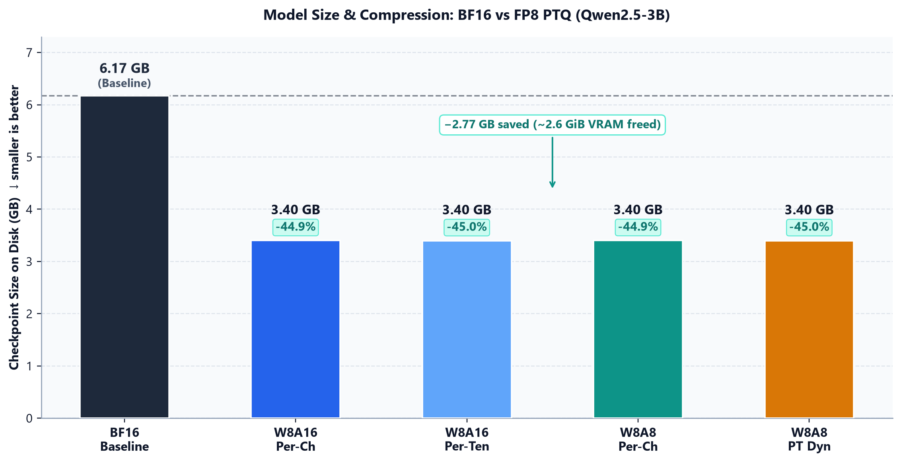
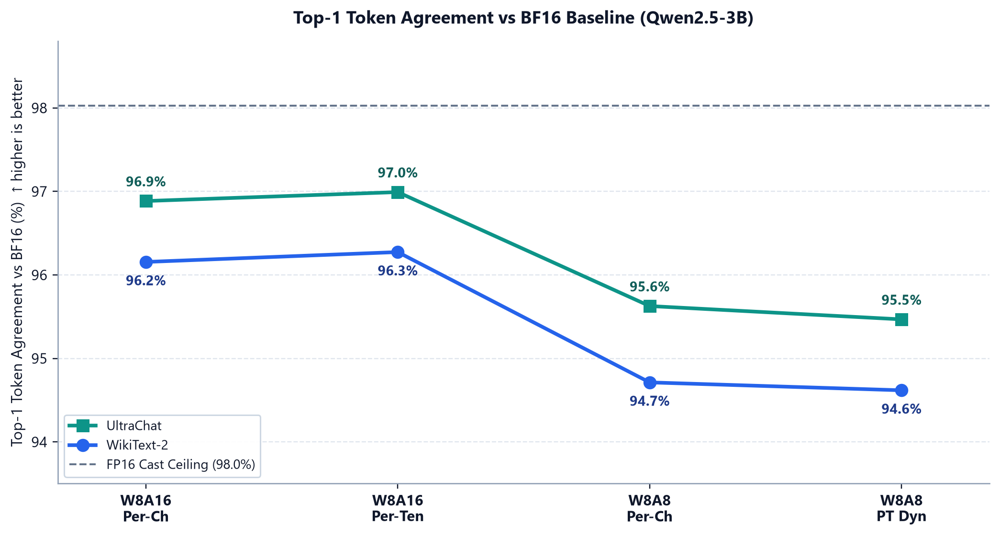
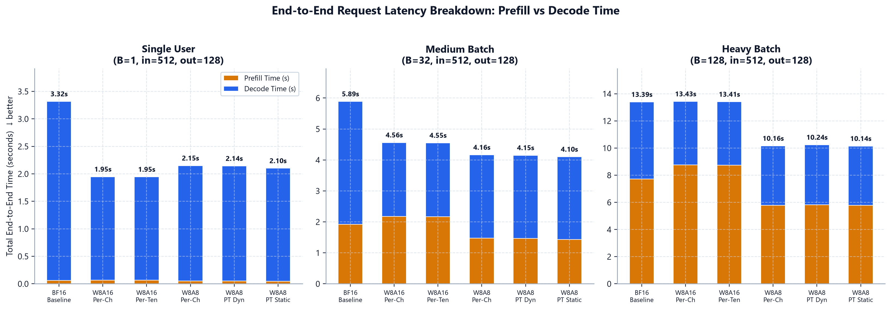
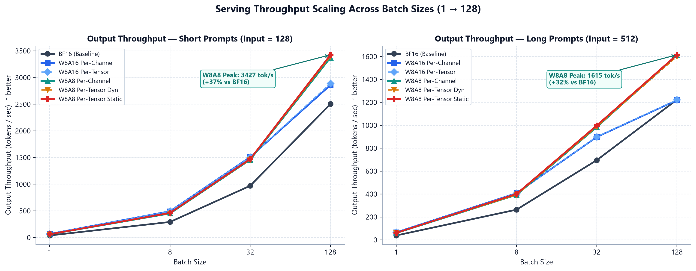

# FP8 Post-Training Quantization Study — Management Presentation
**Model:** `Qwen/Qwen2.5-3B` (BF16 Baseline) | **GPU:** NVIDIA L4 (Ada, 24 GB) | **Serving:** `vLLM 0.34.0`

> **Format:** 10 Slides | **5 Core Plots** | **2 Summary Tables** | ~10 min presentation

---

## Slide 1: Executive Summary — Lead With the Decision

**Objective:** Evaluate whether pure **FP8 Post-Training Quantization (PTQ)** cuts model size and latency on NVIDIA L4 **with zero fine-tuning and zero accuracy loss**.

### Bottom Line
- **45% smaller model (`6.17 GB → 3.40 GB`)** across all 5 FP8 methods — freeing `~2.6 GiB` VRAM for KV cache.
- **Zero downstream accuracy loss** on our two winning models across `16,695` zero-shot questions (`69.0%` vs BF16 `68.9%`).
- **Clear workload-based deployment rule:**
  - **Low-batch / interactive (`≤ 32` users):** Deploy **`w8a16_pc`** — **1.74× faster decode** (`14.7 ms/tok`) & best quality.
  - **High-concurrency / long prompts (`64–200+` users):** Deploy **`w8a8_pc`** — **+35% peak throughput** & **1.34× faster prefill**.
  - **Avoid `w8a8_pt_static`:** Needs calibration, `+45%` worse KL shift, and the only `p < 0.01` accuracy drop for `<2%` speed gain.

---

## Slide 2: Experiment Setup & The 5 FP8 Recipes

- **Pure PTQ only:** One-shot FP8 E4M3 conversion via `llm-compressor` — zero QAT, zero fine-tuning, zero gradients.
- **Scope:** All **252 Linear layers** (36 decoder blocks) quantized to real `.safetensors` checkpoints; embeddings, norms, and `lm_head` kept in `bfloat16`.
- **Dual-track rigor:** Real checkpoints benchmarked live in `vLLM` on L4 (cc `8.9`, Marlin kernel for W8A16, native FP8 Tensor Cores for W8A8), cross-validated against PyTorch simulation (`0.06%` BF16 PPL agreement, `RMSE = 4.0×10⁻⁴`).

### Table 1: Evaluated FP8 PTQ Recipes
| Recipe | Weights | Activations | Calibration? | L4 Serving Kernel |
|---|---|---|---|---|
| **`w8a16_pt`** | FP8 Per-Tensor | BF16 | No | Marlin (weight-only) |
| **`w8a16_pc`** | FP8 Per-Channel | BF16 | No | Marlin (weight-only) |
| **`w8a8_pc`** *(FP8_DYNAMIC)* | FP8 Per-Channel | FP8 Dynamic Per-Token | No | Native FP8 Tensor Cores |
| **`w8a8_pt_dyn`** | FP8 Per-Tensor | FP8 Dynamic Per-Tensor | No | Native FP8 Tensor Cores |
| **`w8a8_pt_static`** | FP8 Per-Tensor | FP8 Static Per-Tensor | Yes (512 samples) | Native FP8 Tensor Cores |

---

## Slide 3: What We Measured (Metrics & Zero-Shot Benchmarks)

- **Zero-Shot Accuracy (`16,695` questions, no prompt examples):** Tests pure pre-trained reasoning & knowledge retention via `lm-eval` (paired exact McNemar test vs BF16):
  - **HellaSwag** (`10,042` Qs, commonsense completion) · **ARC-Easy** (`2,376`, grade-school science) · **ARC-Challenge** (`1,172`, hard science reasoning) · **WinoGrande** (`1,267`, pronoun context) · **PIQA** (`1,838`, physical intuition).
- **Full-Vocab KL Divergence & Perplexity (`262k` tokens):** Measures exact probability shift across all `152,064` vocabulary tokens on WikiText-2 and UltraChat — far sharper than coarse multiple-choice accuracy.
- **Serving Latency & Throughput:** Real `vLLM` timings across 8 `(batch 1–128 × input 128/512)` workloads measuring **TPOT** (ms/token), **Prefill/TTFT** (s), and **Output tok/s**.

---

## Slide 4: Model Size & Compression

- **Identical ~45% compression:** Every FP8 checkpoint shrinks from **`6.17 GB` (`5.75 GiB`) → `3.40 GB` (`3.16–3.17 GiB`)**, saving `2.77 GB` on disk and `~2.6 GiB` in GPU VRAM.
- **Per-channel scaling is virtually free:** Adds only `2.1 MB` (`0.06%`) of scale tensors over per-tensor.
- **Remaining 55%:** Unquantized `bfloat16` embeddings and `lm_head` (intentionally preserved to protect output logits).

---

## Slide 5: Zero-Shot Downstream Accuracy (Per-Tensor & Per-Channel)

- **No accuracy collapse:** Both Per-Tensor and Per-Channel FP8 methods match BF16's `68.89%` 5-task average (`69.01%–69.32%`), staying within normal task variance.
- **Zero statistically significant drops** on any benchmark for **`w8a16_pc`**, **`w8a16_pt`**, and **`w8a8_pc`** (exact McNemar test across `16,695` questions).
- **Static scaling is the sole outlier:** `w8a8_pt_static` (`69.16%` avg) is the **only** method with a `p < 0.01` drop on HellaSwag (`73.56% → 73.13%`, `-0.43%`).

---

## Slide 6: Distribution Fidelity — Top-1 Token Agreement & KL Shift

- **W8A16 preserves `96.2%–97.0%` exact next-token agreement** with BF16 across WikiText-2 and UltraChat — closely approaching the harmless FP16 cast ceiling (`98.0%`).
- **Activation quantization (`W8A8` vs `W8A16`) is the main fidelity drop:** Top-1 agreement steps down by `~1.5 pp` (`96.2% → 94.7%` on WikiText, `96.9% → 95.6%` on UltraChat) as full-vocab KL roughly doubles (`0.0058 → 0.0105`, `p < 0.001`).
- **Clear monotonic quality ranking (confirmed by WikiText-2 PPL):** `w8a16_pc` (`7.804`) ≈ `w8a16_pt` (`7.809`) > `w8a8_pc` (`7.834`) > `w8a8_pt_dyn` (`7.855`) > `w8a8_pt_static` (`7.866`, `94.0%` top-1, `+45%` worse KL).

---

## Slide 7: Root Cause — *Why* Activation Quantization & Static Scales Hurt

Our 252-layer diagnostic sweep (`layer_diag.py`) explains the exact mechanism behind the metrics:

- **Weights are smooth (not the bottleneck):** Mean weight SQNR is **`31.54 dB` (per-tensor)** vs **`31.56 dB` (per-channel)** — explaining why `w8a16_pt` and `w8a16_pc` perform almost identically.
- **Extreme activation outliers in `down_proj`:** SwiGLU MLP inputs to early `down_proj` layers spike by **`1.58 × 10⁷×`** the median in Layer 2 (`5.9 × 10⁵×` in L1, `5.4 × 10⁵×` in L3).
- **Why dynamic per-token wins:** Fixed static scales (`w8a8_pt_static`) get distorted by these spikes and crush normal activations; dynamic per-token scaling (`w8a8_pc`) isolates outlier tokens on the fly.
- **Mixed-precision lever:** Sensitivity is U-shaped — **Layer 35, Layer 0, Layer 2**, and **`down_proj`** dominate total KL, while middle layers (5–28) are highly robust.

---

## Slide 8: End-to-End Latency Breakdown & The L4 Hardware Crossover

- **Single User & Low Batch (`B ≤ 32`):** Decode time dominates (`>95%` of latency) and is memory-bandwidth bound. **`w8a16_pc`** wins decisively at **`1.95s`** vs BF16 `3.32s` (**1.70× faster end-to-end**, **1.74× decode speedup**) by eliminating dynamic activation overhead.
- **The Crossover at Heavy Batch (`B = 128`):** Prefill dominates total latency (`~60%` of request time) and becomes compute-bound. **`w8a8_pc`** overtakes `w8a16` with native Ada FP8 Tensor Cores — cutting prefill to **`5.78s`** vs `8.76s` and total request latency to **`10.16s`** vs `13.43s` (**1.32× faster**).
- **Weight Granularity is Speed-Neutral:** Per-channel matches per-tensor speed within `<1%`, confirming per-channel is a completely free quality upgrade.

---

## Slide 9: Serving Throughput Scaling (Batch 1 → 128)

- **Short prompts (`in=128`, left):** At `B=128`, **`w8a8_pc`** scales to **`3,374 tok/s` (+35% vs BF16)** on native Ada FP8 Tensor Cores, beating `w8a16_pc` (`2,860 tok/s`, `+14%`).
- **Long prompts (`in=512`, right):** **`w8a16_pc`** flattens right onto the BF16 curve (`1,220` vs `1,223 tok/s`, **0% gain**), whereas **`w8a8_pc`** sustains **`1,613 tok/s` (+32%)** — making it the clear choice for **200+ concurrent users** and RAG workloads.
- **Static adds `<2%` extra throughput:** `w8a8_pt_static` (`3,427 tok/s`) is virtually tied with `w8a8_pc` (`3,374 tok/s`), confirming static calibration is not worth the quality loss.

---

## Slide 10: Master Scorecard, Deployment Recommendation & Next Steps

### Table 2: Master Comparison Scorecard (`Qwen2.5-3B` on NVIDIA L4)
| Method | Size (Saved) | 5-Task Avg Acc | WikiText PPL (Δ) | Mean KL | B=1 Decode | B=128 Throughput (`in=128` / `512`) | Decision |
|---|---:|---:|---:|---:|---:|---:|---|
| **BF16 (Baseline)** | 6.17 GB (0%) | 68.89% | 7.782 (—) | 0.0000 | 25.6 ms | 2,504 / 1,223 tok/s | Baseline |
| **`w8a16_pc`** | **3.40 GB (-44.9%)** | **69.09% (ns)** | **7.804 (+0.022)** | **0.0058** | **14.7 ms (1.74×)** | 2,860 / 1,220 tok/s | **Ship: Low-Batch (`≤32`)** |
| **`w8a16_pt`** | 3.40 GB (-45.0%) | 69.09% (ns) | 7.809 (+0.027) | 0.0056 | 14.7 ms (1.74×) | 2,891 / 1,222 tok/s | Viable alt (`w8a16_pc` cleaner on chat) |
| **`w8a8_pc`** | **3.40 GB (-44.9%)** | **69.01% (ns)** | **7.834 (+0.052)** | **0.0105** | 16.4 ms (1.56×) | **3,374 / 1,613 tok/s (1.35×)** | **Ship: High-Batch (`64–200+`)** |
| **`w8a8_pt_dyn`** | 3.40 GB (-45.0%) | 69.32% (`*` HS) | 7.855 (+0.073) | 0.0114 | 16.4 ms (1.56×) | 3,397 / 1,600 tok/s | Dominated by `w8a8_pc` |
| **`w8a8_pt_static`** | 3.40 GB (-45.0%) | 69.16% (`**` HS) | 7.866 (+0.084) | 0.0152 | 16.0 ms (1.59×) | 3,427 / 1,615 tok/s | **Do not deploy** |

### Final Action Plan
1. **Deploy immediately:** Use **`w8a16_pc`** for interactive/low-batch services and **`w8a8_pc` (`FP8_DYNAMIC`)** for high-concurrency (`64–200+` users) APIs — both checkpoints are verified and downloaded.
2. **Next phase (`int_8/`):** Run **INT8 PTQ** through this exact harness to deliver a direct **BF16 vs FP8 vs INT8** comparison.
3. **Optional hardening:** 5-shot MMLU benchmark + mixed-precision test (keeping Layer 0, 2, 35 `down_proj` in BF16).
